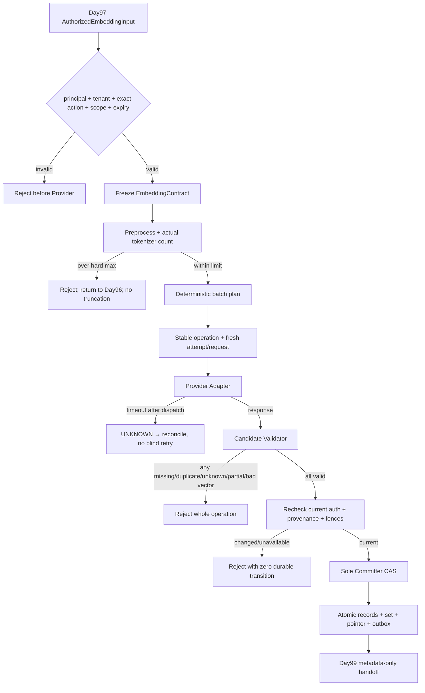

# Day 98 — Embedding Model Selection and Versioning

## 1. Lesson Metadata

- Phase: 7C — Production RAG Engineering.
- Prerequisites: Day95 active immutable `DocumentVersion`; Day96 selected committed `ChunkSet`; Day97 exact
  `chunk:read_for_embedding` permit and provenance-preserving handoff.
- Evidence: official static research plus dependency-free deterministic fake execution on synthetic data.
- Execution evidence: `EXECUTED_LOCAL_RUNTIME_WITH_DETERMINISTIC_FAKE`.
- Production readiness: `MORE_EVIDENCE_NEEDED`.
- Scope boundary: no real or paid Provider, model weights, vector database/index, retrieval, reranking, answer,
  citation, production traffic or customer data.

## 2. Learning Objectives

By the end of Day98, the learner can:

1. choose candidates with hard eligibility gates before frozen weighted preferences;
2. explain why model, immutable revision, tokenizer, preprocessing, input role and normalization jointly define
   a vector space;
3. accept only Day97 input authorized for the exact principal/tenant/action/scope and still-valid permit;
4. count with the actual frozen tokenizer and reject overflow instead of silently truncating;
5. create deterministic batches that split only between already committed Chunks;
6. correlate every response to one stable `chunk_id` and reject missing, duplicate, unknown or partial output;
7. distinguish stable operation identity, fresh attempts, proven non-execution and timeout `UNKNOWN`;
8. recheck current authorization/provenance/fences before the sole Committer atomically publishes an immutable
   homogeneous `EmbeddingSet`.

## 3. Why This Matters

An embedding is not “just a list of floats.” Its meaning depends on the exact model space and the exact
transformation that produced it. Two 1,024-dimensional vectors can be incomparable if they came from different
model revisions, prefixes or normalization rules. A technically valid vector can also be unauthorized,
mis-correlated, truncated, stale or only one item in a partial response.

If these facts are not frozen, a silent Provider alias change can mix incompatible vectors. If response order
is trusted, one Chunk can receive another Chunk's vector. If one missing result is accepted, the durable set no
longer corresponds to the authorized input. Day98 makes those failure modes explicit and fail-closed.

## 4. Roadmap Position

```text
Day95 active source/parse lineage
    +
Day96 immutable selected ChunkSet and exact Chunk identity
    +
Day97 exact current authorization and protected text exit
    ↓
Day98 model selection + immutable EmbeddingContract + candidate validation + EmbeddingSet
    ↓
Day99 vector-store and index design
    ↓
Day100 retrieval; Day102 citations; Day103 local quality evaluation
```

Day98 produces versioned vector facts. It does not choose an ANN index or authorize future query access.

## 5. Lesson Map



The important invariant is simple: before `K`, everything is a proposal. No earlier valid batch may leak into
durable state if a later batch fails.

## 6. Core Mental Model

Think of vectors as coordinates on a printed map:

- the model revision chooses the map;
- tokenizer, preprocessing and document/query role decide how words are placed on it;
- dimensions, numeric type and normalization define the coordinate format;
- a vector without its exact map contract is an unlabeled coordinate;
- combining coordinates from two maps does not create a larger map—it creates nonsense.

Think of the Provider as a measurement instrument, not a database authority. It returns measurements. The
application checks the label, count, shape and numeric safety. The Committer alone records the measurement as a
durable fact after verifying the input is still authorized and current.

Durable memory:

```text
same dimensions ≠ same vector space
Provider response ≠ EmbeddingSet
batch success ≠ operation success
timeout ≠ failure
ACL change ≠ content/model change
```

## 7. Main Concepts

### Concept 1: Hard gates before preference scores

#### Tech Lead Question

Can a cheap, fast model win if the team cannot pin its exact revision or approve protected-text egress?

#### Student Thinking and Answer

The learner rejected the shortcut. A weighted total cannot compensate for a failed safety or compatibility
gate. Weights must also be frozen before seeing results to prevent goalpost movement.

#### Tech Lead Review

Day98 freezes exact-revision, tokenizer, no-truncation, response-correlation, protected-data handling and tenant
isolation gates. Only eligible candidates receive the 35/25/15/10/10/5 preference score. The research compares
OpenAI `text-embedding-3-large`, Cohere `embed-v5.0-pro`, and an exact BGE-M3 Hugging Face revision. BGE-M3 is
provisional because it can be pinned and self-hosted; its local-quality contribution is zero because the real
runtime/corpus were not run. Public benchmarks remain context, not local proof.

The deterministic fake also emits content-safe request/item, token/byte, latency and estimated-cost observations.
These prove evidence plumbing, not real Provider pricing or performance.

#### Exercise

Give a hosted alias perfect cost/latency scores but fail exact revision pinning. Verify it is rejected before
scoring.

### Concept 2: Freeze the complete EmbeddingContract

#### Tech Lead Question

If two models output 1,024 floats, can their vectors share one index?

#### Student Thinking and Answer

The learner said no: equal shape does not preserve similarity semantics. The corrected contract also includes
tokenizer, preprocessing and input role/prefix.

#### Tech Lead Review

The contract fingerprint binds provider/model/exact revision/deployment, tokenizer/exact revision,
preprocessing, `DOCUMENT` role/prefix, token hard maximum, overflow `REJECT`, dimensions/type/normalization,
API/schema versions, batch limits and egress/retention policy. Any semantic change creates a new immutable set;
old sets remain for audit and rollback. Query inputs cannot accidentally use the document role.

#### Exercise

Change only the prefix or normalization policy. Confirm the fingerprint and stable set identity change.

### Concept 3: Exact eligibility and deterministic batching

#### Tech Lead Question

What should happen when one committed Day96 Chunk exceeds the selected model's token limit?

#### Student Thinking and Answer

The learner rejected truncation because decisive information may be in the final tokens. The whole input is
rejected and returned to Day96 for a new versioned ChunkSet.

#### Tech Lead Review

Only the Day97 handoff for `chunk:read_for_embedding` enters preprocessing. It preserves ordered `chunk_id`,
content hash and source spans. The actual frozen tokenizer counts the exact prefixed text. The batch planner
groups complete Chunks by item/token/byte ceilings and never splits or rewrites a Chunk. Identical input and
contract produce identical batches and IDs.

#### Exercise

Set the batch byte limit below one Chunk. Confirm a clear error, not an automatically shortened Chunk.

### Concept 4: Correlation and all-or-nothing candidate validation

#### Tech Lead Question

May the application accept four valid results if the fifth result is missing or duplicated?

#### Student Thinking and Answer

The learner correctly said no: this is simultaneously a duplicate and missing relationship problem, so the
whole batch/operation is rejected. Provider position alone is insufficient without a proven exact mapping.

#### Tech Lead Review

The adapter sends an application `batch_id` plus stable `chunk_id` identities. The validator checks request and
batch correlation, exact model identity, non-partial response, count, unique complete IDs, dimensions, finite
values, forbidden zeros and unit-norm tolerance. Out-of-order results are acceptable only when explicit IDs
restore exact source order. Provider usage is classified `EXACT`, `ESTIMATED` or `UNKNOWN`.

#### Exercise

Run fake modes for reverse, missing, duplicate, unknown, wrong model/dimension, NaN, infinity, zero and partial.
Only the explicitly correlated reverse response may commit.

### Concept 5: Stable operation, fresh attempt and uncertain dispatch

#### Tech Lead Question

Can a timed-out request be sent again with the same side-effect identity?

#### Student Thinking and Answer

The learner rejected blind retry because it can create a second Provider side effect. Timeout after dispatch is
unknown, not proven failure.

#### Tech Lead Review

Stable operation/idempotency identity names the desired result. Each execution has a fresh attempt number,
generation and request ID. Connect failure proven before dispatch permits a fresh attempt. Timeout after
dispatch becomes `RECONCILIATION_REQUIRED`; without an authoritative Provider status/idempotency capability,
execution stops. Rate limits use bounded exponential backoff, jitter and `Retry-After` as a lower bound.

#### Exercise

Compare `PROVEN_NOT_EXECUTED` with `TIMEOUT_UNKNOWN`. Only the first may directly create attempt 2.

### Concept 6: Current-state recheck and sole atomic Committer

#### Tech Lead Question

What if ACL, selected ChunkSet or document fence changes while vectors are being calculated?

#### Student Thinking and Answer

The learner required a current authorization recheck before commit and a sole Committer that creates an
immutable `EmbeddingSet`.

#### Tech Lead Review

The Committer rereads permit expiry, active membership, every authorization revision/epoch, active
DocumentVersion, selected ChunkSet, provenance and fences. Any change or outage commits nothing. Under one
modeled transaction it checks the attempt fence and pointer baseline, inserts records and set, advances the
current pointer and inserts Outbox intent. Exact duplicates converge. One CAS winner exists. A different vector
manifest under the same stable result identity is a conflict.

ACL-only changes invalidate the in-flight permit and future query rights but do not alter content or vector
space; they do not automatically require re-embedding. Model, tokenizer or preprocessing changes do.

#### Exercise

Expire the permit or advance selection revision after Provider response. Verify zero records, set, pointer and
Outbox transition.

## 8. Common Misconceptions

- **Embedding completed means store it.** No. It is an untrusted candidate until validation and commit.
- **Response order is enough.** Only if the Provider contract proves exact complete index correlation and the
  adapter validates it; application IDs are safer.
- **Partial success saves money.** It breaks the exact input/set relationship and creates repair ambiguity.
- **Timeout means retry.** It means outcome unknown after possible dispatch.
- **The last tokens are expendable.** Silent truncation can remove the decisive meaning.
- **Same dimension means compatible.** Vector spaces depend on the whole contract.
- **A public leaderboard selects production quality.** Local frozen retrieval/answer evidence is still needed.
- **A fake adapter proves the model.** It proves application control flow only.
- **Vectors are harmless.** They are derived protected data and may leak information.
- **ACL revision requires new embeddings.** Not unless content or the vector-space contract changed.
- **Cross-tenant content hashes are safe dedup keys.** Equality itself can leak and cannot merge ownership.

## 9. Engineering Trade-offs

| Choice | Benefit | Cost / remaining risk |
|---|---|---|
| Exact artifact pin | Reproducible space | Operational upgrade work |
| `REJECT` overflow | No hidden semantic loss | More Day96 re-chunking |
| Explicit item identity | Safe out-of-order handling | Adapter complexity |
| Whole-operation rejection | Simple exact truth | Recomputes earlier valid batches |
| Precommit live recheck | Prevents stale authorization/provenance commit | More latency/state reads |
| Immutable versioned sets | Audit/rollback and no mixed spaces | Additional storage |
| Self-hosting candidate | Egress control and artifact pinning | Capacity/security/ops ownership |
| Deterministic fake | Fast exhaustive failure tests | No real quality/runtime evidence |

## 10. Hands-on Exercises

```bash
PYTHONPATH=projects/ai-agent/src:projects/ai-agent python3.12 \
  projects/ai-agent/examples/day98_embedding_selection_versioning.py
PYTHONPATH=projects/ai-agent/src:projects/ai-agent python3.12 \
  projects/ai-agent/evals/run_day98_seed_eval.py
PYTHONPATH=projects/ai-agent/src:projects/ai-agent python3.12 -m unittest discover \
  -s projects/ai-agent/tests -p 'test_day98_*.py' -v
```

Inspect:

- [application design](../../projects/ai-agent/docs/DAY98_EMBEDDING_MODEL_SELECTION_VERSIONING.md)
- [model evidence](../../projects/ai-agent/research/day98-embedding-model-evidence.jsonl)
- [selection decision](../../projects/ai-agent/research/day98-embedding-selection-decision.md)
- [validation record](../../projects/ai-agent/evidence/day98-validation.json)
- [Day99 handoff](../../projects/ai-agent/docs/DAY98_TO_DAY99_HANDOFF.md)

## 11. Relevant Framework Connections

OpenAI/Cohere SDK objects, Hugging Face tensors and tokenizer internals stay behind an Adapter. The application
owns identities, roles, overflow, correlation, candidates, validation outcomes and durable records. A future
model framework may implement the port, but it cannot choose the Committer's identity, authorization or CAS
semantics. A vector database belongs to Day99 and cannot retroactively validate Day98 input.

## 12. AI Backend Connections

Embeddings connect protected document processing to retrieval infrastructure. That boundary combines model
reproducibility, security, dispatch uncertainty, numerical validation, idempotency and lifecycle versioning.
The same candidate/validator/Committer pattern used earlier in the course prevents external output from becoming
authority. Content-safe evidence records IDs/fingerprints/counts/reasons—not text or vector coordinates.

## 13. English Interview

### Key vocabulary

`embedding space`, `immutable revision`, `tokenizer`, `preprocessing`, `input role`, `silent truncation`,
`correlation`, `partial response`, `dispatch uncertainty`, `reconciliation`, `normalization`, `atomic commit`.

### Useful expressions

- “Equal dimensionality does not imply vector-space compatibility.”
- “The Provider response is a candidate, not a durable fact.”
- “A timeout after dispatch is unknown and requires reconciliation.”
- “Any missing, duplicate or unknown item rejects the whole operation.”

### Beginner question

Why must an embedding record retain its contract fingerprint?

### Intermediate question

How do stable operation identity and fresh attempt identity prevent unsafe retries?

### Senior question

Design the full authorized Chunk-to-EmbeddingSet boundary, including model selection, truncation, correlation,
TOCTOU rechecks, concurrency and version upgrades.

### Common weak answer

“Call the embedding API and store vectors by array position.” It omits authorization expiry, tokenizer and
preprocessing compatibility, correlation, partial responses, dispatch uncertainty, current-state checks and
atomic versioned commit.

### Strong answer

“I freeze hard gates and weighted preferences, then bind an exact model/tokenizer/preprocessing contract. I
admit only the exact Day97 authorized scope, count with the real tokenizer, reject overflow, and create stable
batches. Each fresh attempt carries request/batch/item correlation. I validate the complete candidate and treat
post-dispatch timeout as unknown. Immediately before one atomic CAS commit I reread authorization, provenance
and fences. Model-space changes create a new immutable set; ACL-only changes do not rewrite vectors.”

Direct teaching was required for the complete contract, usage confidence, retry state machine and Day99
boundary. The classroom does not claim independent senior-English performance.

## 14. Mental Model Summary

```text
authorized current chunks
+ frozen vector-space contract
+ deterministic batching/correlation
+ complete numeric/structural validation
+ current-state recheck
+ sole atomic Committer
= immutable homogeneous EmbeddingSet
```

Everything before the final equation is necessary. Removing one term makes the result ambiguous, stale,
unauthorized or incompatible.

## 15. Today's Takeaway

The key Day98 product is not a vector. It is a trustworthy relationship between one authorized current Chunk
occurrence, one exact vector-space contract and one immutable record inside an atomically published set. Model
selection, retries and upgrades are all constrained to preserve that relationship.

## 16. Before Next Lesson Checklist

- [x] Three candidates have source-linked static evidence and unresolved facts.
- [x] Hard gates precede frozen weighted preferences.
- [x] Model/tokenizer/preprocessing/role/token/vector/API/batch/egress contract is immutable.
- [x] Day97 handoff preserves principal/action/scope/expiry/revisions and provenance fences.
- [x] Actual tokenizer overflow rejects without truncation.
- [x] Deterministic batching never splits a committed Chunk.
- [x] Stable operation and fresh attempt/request identities are separate.
- [x] Missing/duplicate/unknown/partial/wrong/numerically invalid output rejects the operation.
- [x] Timeout `UNKNOWN`, proven non-execution and rate-limit behavior are distinct.
- [x] Precommit authorization and provenance are reread.
- [x] Sole Committer atomically establishes records/set/pointer/Outbox and preserves old sets.
- [x] Content-safe example, seed and local deterministic tests execute.
- [ ] Real candidate weights/runtime and frozen local retrieval/answer quality run.
- [ ] Production vector protection, durable transaction/dispatcher/reconciliation and load/soak run.
- [ ] Day99 creates and evaluates a versioned vector index.

Production readiness remains `MORE_EVIDENCE_NEEDED`.
