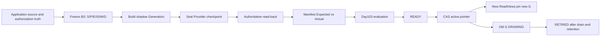

# Day104 Application Design — Index Generation Lifecycle

## Scope

Day104 keeps one refund-policy RAG index correct while its source, authorization,
deletion state and serving generation change. The L2 implementation is a
deterministic, process-local model of immutable generations, read-back validation,
quality evidence, pointer CAS, leased ReadViews, deletion evidence, drain,
retirement and rollback.

It does **not** run PostgreSQL, a real vector database, a broker, distributed
workers or production traffic. Its locks and in-memory dictionaries model
transaction boundaries for deterministic tests; they are not durability or
zero-downtime evidence.

## Fixed refund case

The lesson deliberately keeps one case stable so that each lifecycle change is
visible:

```text
A@v1 — current refund policy: unopened items may be refunded within 14 days
B@v1 — superseded historical policy: 30 days
C@v1 — current service manual: apply through online customer service

Q1 — refund window                    → A@v1
Q2 — submission channel               → C@v1
Q3 — refund window + submission       → A@v1 + C@v1
```

`B@v1` remains useful as an independent evaluation distractor, but it is not
eligible current production content. A deletion snapshot may Tombstone B while
the immutable source history remains available for audit.

The frozen build identity is:

```text
BS1 = S1 + P1 + E1 + IS1 + W1 + D1

S1  — Source Snapshot
P1  — Authorization Snapshot
E1  — Embedding Contract
IS1 — Index Schema / physical contract identity
W1  — authoritative source watermark
D1  — Deletion Snapshot
```

Changing any build-relevant binding creates a different `BuildSnapshot`
fingerprint. A display label such as `build_snapshot_id` does not change the
stable fingerprint when the underlying bindings are identical.

## Roadmap connection

```text
Day95  durable document lifecycle and Tombstone
Day97  authorization and provenance snapshots
Day98  immutable EmbeddingSet and contract
Day99  shadow vector generation, manifest and read-back
Day100 request-time authorization and selected bundle
Day103 frozen evaluation ruler and release decision
Day104 generation update/delete/rebuild/migration lifecycle
```

Day104 consumes these earlier contracts. It does not replace their ownership
boundaries.

## Architecture



The application database is the intended control-plane authority. A Provider
alias is a derived projection. An Outbox event is a wake-up hint; a consumer
must reread application truth rather than trust delayed event order.

## Ownership model

### Source and authorization truth

The application Source Store owns which refund policy is current. The
authorization store owns who may read it. `S1` and `P1` are immutable snapshots
of those facts, not independent owners.

### Derived Generation

A Generation is a rebuildable view. Its vectors and payloads may be durable on
disk while still being semantically derived. After seal, its artifact identity
and contents cannot be rewritten.

### Mutable control state

The active pointer, lifecycle state, reader leases and Outbox state are mutable
control-plane facts. Each mutation is guarded by revision, state and fencing
checks.

## Artifact and lifecycle separation

`GenerationArtifact` contains immutable release identity:

- generation and scope IDs;
- BuildSnapshot fingerprint;
- Manifest digest;
- frozen Day103 EvaluationRuler fingerprint;
- exact ValidationRecord and EvaluationEvidence digests;
- evaluation report checksum;
- physical namespace.

`GenerationLifecycle` contains guarded mutable state:

- `state` and monotonic `state_version`;
- transition fence;
- active-reader summary;
- optional rollback-retention deadline.

The canonical mainline is:

```text
BUILDING → VALIDATING → READY → ACTIVE → DRAINING → RETIRED
               │          │
               └──────────┴────────────→ FAILED on observed failure
```

`DRAINING → ACTIVE` is allowed only as a new, fully revalidated rollback CAS.
`RETIRED` and `FAILED` are terminal for that artifact. An evaluator timeout does
not prove failure: `INCONCLUSIVE` remains `VALIDATING` so the same sealed
candidate can be evaluated again under the same ruler.

## Build, seal and read-back

The Builder produces **Expected** facts from the trusted BuildSnapshot. The
Validator produces **Actual** facts from an authoritative read-back of a sealed
Provider namespace. They are intentionally separate owners.

Manifest comparison covers:

- count derived from exact occurrence IDs;
- sorted unique exact occurrence IDs;
- per-corpus content digest;
- metadata digest;
- provenance digest;
- exact expected-absent Tombstone IDs.

Equal count is insufficient. `{A@v1, C@v1}` and `{A@v1, B@v1}` both contain two
items, but the second set loses current C and reintroduces forbidden B.

The Provider fake models a write fence, stable checkpoint and seal. After seal,
all further writes are rejected. `ValidationRecord` binds generation, namespace,
BuildSnapshot, Expected and Actual Manifest fingerprints, checkpoint, write
fence, validator version and decision. A report for checkpoint `cp17` cannot
authorize a namespace that moved to `cp18`.

## READY release gate

`mark_ready()` is a protected state transition, not a label assignment. It
requires all of the following:

1. lifecycle is still `VALIDATING` at the expected state version;
2. current `S/P/E/IS/W/D` still matches the frozen BuildSnapshot;
3. Provider seal/checkpoint/fence matches validation evidence;
4. Manifest integrity and expected-absence checks pass;
5. Day103-compatible evaluation evidence binds the same Generation, Manifest,
   dataset, evaluator and policy;
6. evaluation decision is `PASS`.

An observed integrity or evaluation failure moves the candidate to `FAILED`.
Missing evidence or `INCONCLUSIVE` leaves it in `VALIDATING`. No weighted score
may compensate for a hard-gate failure.

## Atomic activation and alias projection

Activation models one application transaction:

```text
pointer: G1/r7 → G2/r8
G2: READY → ACTIVE
G1: ACTIVE → DRAINING
append ActivationRecord
append INDEX_POINTER_CHANGED Outbox event
```

The transaction requires the expected pointer generation/revision, a current
authority-issued Committer lease/fence, one successor per pointer revision, a current target
BuildSnapshot and a READY or rollback-eligible DRAINING target.

The Provider alias call happens after commit. If the process crashes between the
database commit and projection, the pending Outbox event drives reconciliation.
If the Provider applied the alias but the ACK was lost, the retry read-backs the
already-correct alias and converges without incrementing the pointer revision.
A delayed old Outbox event is only a wake-up signal: it rereads and projects the
current database pointer, then terminates the old event. It cannot reverse the
current database pointer or remain pending forever.

Pointer revisions are monotonic even when the selected Generation returns to an
older artifact:

```text
G1/r7 → G2/r8 → G1/r9
```

This prevents the ABA problem and rejects stale CAS attempts that still expect
`G1/r7`.

## ReadViews, drain and retirement

`acquire()` atomically checks pointer generation/revision and ACTIVE lifecycle,
creates an OPEN leased ReadView, and increments the reader summary. A pointer
race returns `STALE_POINTER`; the request rereads the pointer rather than joining
an already-DRAINING Generation.

Each ReadView binds:

- view, pointer and Generation identities;
- pointer revision and BuildSnapshot fingerprint;
- authorization snapshot identity;
- owner, fencing token and lease deadline.

Heartbeat and release require the current fence. A Reaper converts an expired
OPEN lease to `EXPIRED`, increments its fence and decrements the reader count
exactly once. A late release using the old fence cannot decrement again.

The ReadView ledger is authoritative; `active_readers` is a fast summary. A
ledger/count mismatch blocks retirement and requires an audited reconciliation.
Retirement additionally requires:

- state is `DRAINING`;
- zero OPEN ReadViews;
- reader ledger and summary agree;
- rollback-retention deadline has passed.

`RETIRED` means no longer serving. It does not claim physical erasure.

## Delete, rebuild and anti-resurrection

Deletion intent, its immutable verification policy, Tombstone revision and
Outbox event are committed together in the deterministic ledger model. Exact replay converges to the first result;
reusing an operation/idempotency identity with a different digest is a conflict.
Inbox processing follows the same rule.

Every later BuildSnapshot binds the current `DeletionSnapshot`. If D1 changes to
D2 while a candidate is building, its READY transition fails currentness rather
than rewriting the sealed Generation. This prevents a historical source replay
from resurrecting B.

Deletion evidence is deliberately scoped:

```text
LOGICAL_RELEASE        response gates cannot publish B
SERVING_INDEX_ABSENCE  every still-servable Generation is read-back without B
PHYSICAL_PURGE         Provider/cache/managed storage satisfies erase policy
```

Each evidence record binds the durable policy, trusted validator/version,
pointer revision, exact servable Generation set and exact Tombstone set. The
verified intent retains the adopted snapshot, evidence IDs and aggregate digest.
The validator allow-list is a process-local admission model, not cryptographic
attestation or proof that a real distributed validator deployment is trustworthy.
One scope cannot stand in for another. While an old DRAINING Generation still
contains B, logical release may pass, but serving-index absence and physical
purge cannot. Required scopes must all have explicit PASS evidence before a
dispatched DeletionIntent becomes `VERIFIED`.

## Business truth change

If the policy changes from `A@v1 = 14 days` to `A@v2 = 21 days`, the new build is
bound to a new source identity, for example:

```text
BS2 = S2 + P2 + E1 + IS1 + W2 + D1
```

The evaluation labels also become explicit new identities:

```text
Q1 → A@v2
Q2 → C@v1
Q3 → A@v2 + C@v1
```

An old `R1(G1, L1)` report cannot prove `G2` correct under `L2`. Candidate and
baseline comparisons must use the same current dataset, labels, evaluator,
metrics, slices, thresholds and hard gates. Historical reports remain immutable.

An in-flight request pinned to an old Generation still must pass current source
and authorization release gates. If A@v1 is no longer releasable, the entire
attempt is discarded and rerun under a fresh ReadView; partial results from two
Generations are never spliced together.

## Rollback eligibility

Rollback is a new forward CAS, not a revision rewind. A retained Generation is
eligible only when its BuildSnapshot remains compatible with current source,
authorization, embedding, schema, watermark and deletion facts, and its release
evidence remains valid.

G1 cannot be selected merely because it exists. A G1 that contains deleted B or
binds a revoked P1 is rollback-ineligible. The safe response is to repair the
current Generation or build a new one under current facts.

## Deterministic L2 code map

- `src/rag_index_lifecycle_contracts.py` — immutable value contracts.
- `src/rag_index_lifecycle_orchestrator.py` — fake Provider build, seal and read-back.
- `src/rag_index_lifecycle_committer.py` — READY, activation, rollback and alias authority.
- `src/rag_index_read_views.py` — leases, drain reconciliation and retirement.
- `src/rag_index_deletion_ledger.py` — Tombstone, Inbox/Outbox and scoped delete evidence.
- `tests/day104_test_support.py` — shared deterministic fixtures.
- `tests/test_day104_*.py` — contract, lifecycle, failure, deletion and ReadView tests.

## Executable validation

Run from `projects/ai-agent/` with the repository-required Python 3.12+ runtime:

```sh
PYTHONPATH=src:. python3.12 -m unittest discover \
  -s tests -p 'test_day104_*.py' -v

PYTHONPATH=src:. python3.12 -m unittest discover -s tests -q

python3.12 -m compileall -q src tests
```

Exact counts and runtime versions belong in the repository update report and
validation evidence only after those commands actually run.

## Evidence boundary

The current implementation can provide
`EXECUTED_LOCAL_RUNTIME_WITH_DETERMINISTIC_FAKE` evidence for deterministic
contract, state-machine, fencing, CAS, idempotency, read-back, lease and recovery
mechanics after its tests pass.

It cannot provide `INTEGRATION_RUNTIME` or `PRODUCTION` evidence. The following
remain `NOT_RUN` unless separately executed and recorded:

- PostgreSQL transactions, isolation, row locks and unique constraints;
- real vector Provider writes, checkpoints, aliases, ANN and replicas;
- a durable broker, Outbox/Inbox relay and distributed workers;
- real process crash/restart, network partition and clock-skew behavior;
- production source, authorization and deletion stores;
- cache/backup purge and compliance erasure;
- latency, capacity, cost, load/soak and error-rate gates;
- canary/blue-green rollout, production traffic and zero-downtime proof.

Production readiness therefore remains `MORE_EVIDENCE_NEEDED`. L3 requires real
infrastructure integration; L4 requires an explicitly authorized production
deployment and an adequate observation window.
