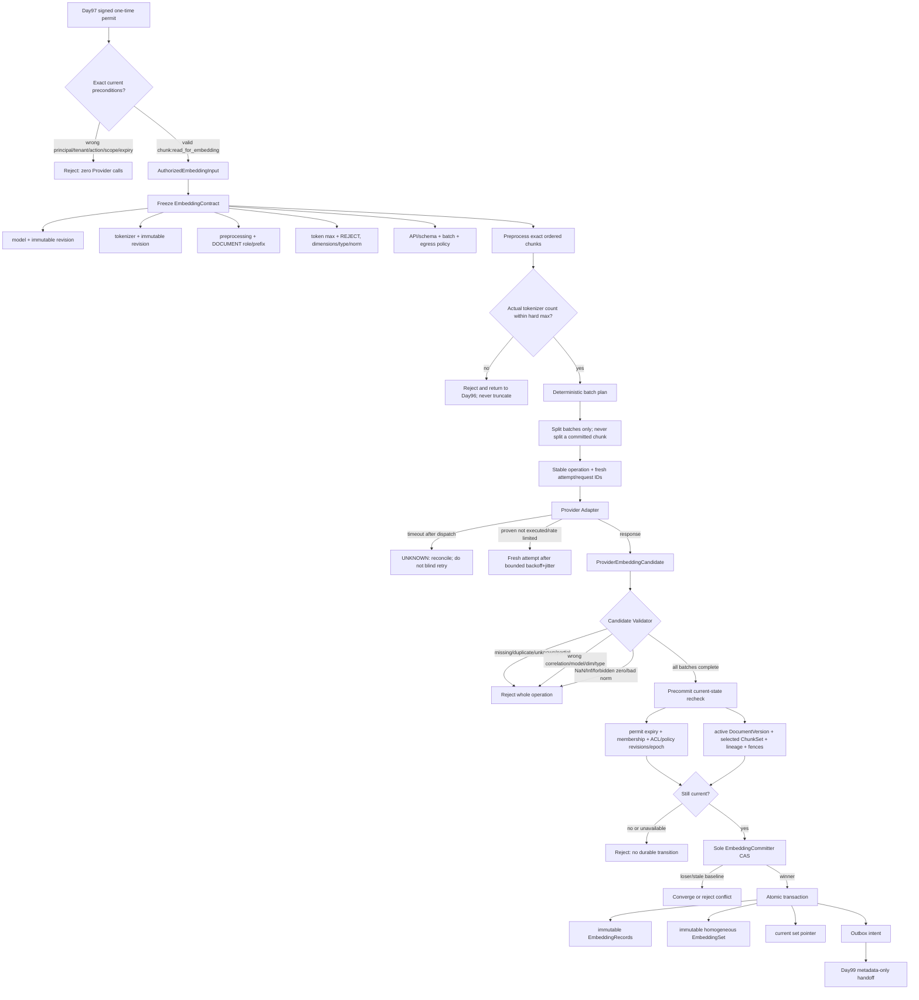

# Day98 Embedding Model Selection and Versioning

## Scope and evidence

Day98 turns the exact Day97 `chunk:read_for_embedding` handoff into one immutable, homogeneous
`EmbeddingSet`. It selects a model by hard gates before weighted preferences, freezes every semantic input to
the vector space, treats Provider output as an untrusted candidate, rechecks current authorization and
provenance immediately before commit, and lets one Committer establish durable truth.

The executable path is dependency-free and uses a deterministic fake. It does not call a paid or real
Provider, install model weights, claim local retrieval quality, build an index, or perform retrieval. Evidence
is `EXECUTED_LOCAL_RUNTIME_WITH_DETERMINISTIC_FAKE`; readiness is `MORE_EVIDENCE_NEEDED`.

## Detailed workflow



Failure nodes never publish a partial set. Earlier valid batches stay candidates in memory only.

## Frozen model-selection method

Hard gates run before scoring:

1. exact model artifact/deployment revision;
2. exact tokenizer artifact revision;
3. explicit overflow `REJECT` and no silent truncation;
4. complete per-item response correlation;
5. approved protected-data egress, retention and vector controls;
6. tenant isolation and no default cross-tenant cache/dedup/batching.

Only an eligible candidate may receive the frozen score: local retrieval quality 35%, security/governance 25%,
reproducibility 15%, reliability/observability 10%, cost 10%, latency/operability 5%. Scores and unresolved
facts remain visible. A benchmark is supporting evidence, not a substitute for the frozen local corpus.

The static research compared OpenAI `text-embedding-3-large`, Cohere `embed-v5.0-pro`, and
`BAAI/bge-m3@5617a9f61b028005a4858fdac845db406aefb181`. BGE-M3 is provisional because it can be pinned and
self-hosted. Real runtime and local retrieval quality remain `NOT_RUN`, so its quality contribution is zero.

## EmbeddingContract

The fingerprint covers:

```text
contract version
+ provider/model/exact revision/deployment
+ tokenizer name/version/exact revision
+ preprocessing version
+ DOCUMENT input role and prefix
+ actual-token hard max and overflow=REJECT
+ dimensions + numeric type + normalization/zero policy/tolerance
+ API version + response schema version
+ per-request item/token/byte limits
+ egress destination/retention/ZDR requirement
```

Equal dimensions do not imply compatible vector spaces. Any model, tokenizer, preprocessing, role/prefix,
dimension, normalization or schema change creates a new fingerprint and therefore a new `EmbeddingSet`. Old
sets remain immutable for audit/rollback. An ACL-only change does not change the vector-space contract or
content, so it does not itself require re-embedding; authorization at commit/query still uses current state.

## Identity and correlation

`operation_id` and tenant-scoped `idempotency_key` identify stable work. A retry uses a new attempt number,
generation and request ID. Each deterministic batch has an application-owned `batch_id`; each response item
must correlate to the exact `chunk_id`. Provider position may be translated only where the Provider contract
proves a complete unique index mapping. Missing, duplicate and unknown identities reject the whole operation.

Timeout after dispatch is `UNKNOWN`. It cannot become permission to send again because the Provider may have
executed. Reconciliation must use an authoritative request-status/idempotency capability; the classroom has no
such Provider capability and therefore stops. A connect failure proven before dispatch can use a fresh attempt.
Rate limits use bounded exponential backoff, deterministic test jitter and `Retry-After` as a lower bound.

## Validation and usage evidence

The candidate validator checks request/batch correlation, exact model identity, non-partial response, count,
unique complete item identity, dimensions, finite values, zero-vector policy and normalization tolerance.
Out-of-order results are valid only because identity—not position—restores source order.

Provider-reported usage is recorded as `EXACT`, adapter-counted usage as `ESTIMATED`, and unavailable usage as
`UNKNOWN`. Usage uncertainty must not be silently presented as exact billing evidence.
Content-safe observations retain request/item counts, input token/byte totals, latency, retry/rate-limit class
and cost with an exact/estimated/unknown confidence; they exclude input text and vector coordinates.

## Sole Committer

Immediately before commit, the Committer verifies:

- permit has not expired and the action is exactly `chunk:read_for_embedding`;
- current membership is active and policy, ACL, membership, role/action catalog, and authorization epoch equal
  the signed handoff;
- current Day95 active version and Day96 selected ChunkSet/provenance still match;
- selection revision, document state version/fence and exact authorized Chunk scope still hold;
- the claim attempt/generation fence and current EmbeddingSet pointer baseline remain current;
- the tenant's selected EmbeddingContract fingerprint/revision is still the one frozen before dispatch;
- every authorized Chunk has exactly one validated vector under one contract.

The in-memory critical section atomically inserts immutable records/set, advances the pointer with CAS, and
adds an Outbox intent. Exact replay returns the existing set. Same stable identity with a different vector
manifest is an identity conflict. Delayed/duplicate delivery is a hint; consumers reread the pointer.

## Data protection

Chunk text, vectors, raw principal IDs and high-cardinality tenant/resource identifiers do not enter ordinary
logs, metrics, seed reports or evidence JSON. Vectors are derived protected data and may be susceptible to
inversion; they require encryption/access/deletion controls. Cache keys and dedup remain tenant-scoped by
default. The committed set retains Chunk IDs, hashes and source spans so later access/deletion/citation work can
preserve occurrence identity.

## Day99 boundary

Day99 may receive immutable set identity, contract fingerprint, dimensions/type/normalization, ordered
EmbeddingRecord IDs and protected storage references. Day98 does not choose a vector database, create an
index, tune ANN parameters, retrieve neighbors, filter ACLs, rerank, answer or cite.

## Validation commands

```bash
PYTHONPATH=projects/ai-agent/src:projects/ai-agent python3.12 -m unittest discover \
  -s projects/ai-agent/tests -p 'test_day98_*.py' -v
PYTHONPATH=projects/ai-agent/src:projects/ai-agent python3.12 \
  projects/ai-agent/evals/run_day98_seed_eval.py
PYTHONPATH=projects/ai-agent/src:projects/ai-agent python3.12 \
  projects/ai-agent/examples/day98_embedding_selection_versioning.py
```
