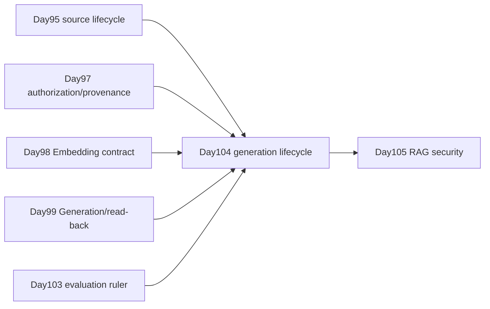

# Day104 Classroom Record — Index Generation Lifecycle

## Teaching mode

The lesson changed Day104's teaching order without discarding its technical
scope. Instead of treating metric calculation as the main line, one refund case
carried the learner through three spiral passes:

1. one thin, complete G1 → G2 migration;
2. one added failure at a time;
3. a real business-truth change from A@v1 to A@v2.

The learner predicted each outcome before the mechanism was explained. A later
L2 extension translated the same invariants into process-local contracts,
transactions, leases and deterministic failure tests.

## Fixed case and identities

```text
A@v1 — current refund policy: 14 days
B@v1 — superseded historical policy: 30 days
C@v1 — current application channel: online customer service

Q1 → A@v1
Q2 → C@v1
Q3 → A@v1 + C@v1
```

The stable identity vocabulary was:

```text
S  Source Snapshot
P  Authorization Snapshot
E  Embedding Contract
IS Index Schema
W  source watermark
D  Deletion Snapshot
BS Build Snapshot
G  immutable Generation
R  evaluation report
```

`B@v1` remained in the synthetic evaluation fixture as a historical distractor,
but was not production-eligible current content.

## Course connection



Day104 is the control layer that keeps the derived retrieval view aligned with
durable source and authorization truth. Day103 measures candidate quality; it
does not own activation.

## Spiral 1 — One complete normal migration

### Durable truth versus derived view

The learner correctly identified S1 as the verified durable refund-policy fact
and G1 as a rebuildable retrieval view. The durable correction was:

> “S1纠正G1，依据事实修改检索索引。”

The learner also understood that index changes cannot rewrite source truth:

> “S1是经过验证的持久化事实，不能因为检索视图发生变化修改持久化事实。”

The lesson later refined this wording: the Source Store owns current truth; S1
is its immutable point-in-time snapshot, not a forever-current database row.

### Generation and pointer

The learner initially described `generation_id` as an alias that should be
combined with a version. The correction separated:

```text
generation_id   immutable artifact identity
active pointer  mutable selected generation + monotonic revision
```

This distinction later enabled the learner to explain ABA risk in
`G1/r7 → G2/r8 → G1/r9`.

### Freeze the BuildSnapshot

The learner chose to freeze the BuildSnapshot before building and correctly
explained that a changed binding destroys the invariant. The completed identity
was:

```text
BS1 = S1 + P1 + E1 + IS1 + W1
```

Deletion work later extended it with D1:

```text
BS1 = S1 + P1 + E1 + IS1 + W1 + D1
```

W1 was defined as the authoritative source cutoff included in S1, not a worker
batch counter or an arbitrary wall-clock timestamp.

### Read-back before READY

After all Provider write acknowledgements succeeded, the learner independently
required:

> “read-back 验证核对 counts、exact IDs、metadata/provenance、content digests；
> Day103 Candidate evaluation再检查质量阈值、关键 slices 和 hard gates。”

The learner also explained why baseline and candidate require one ruler:

> “因为使用同一把尺子，才能稳定测出差异，不然无法确定标准。”

The normal control flow was then reconstructed as:

```text
G2 READY
→ CAS pointer to G2
→ new requests pin G2
→ old requests finish on G1
→ drain G1
→ retire G1 under policy
```

This completed the first spiral pass.

## Spiral 2 — One failure at a time

### Exact retry and identity conflict

For the same operation ID, target, parameters and digest, the learner correctly
required convergence to the first result. For the same operation ID with a
different digest, the learner correctly classified a conflict.

In the manual timeline, the learner first wrote “reflect digest-x 1.” The
correction preserved the original binding instead:

```text
first durable binding: digest-A
later digest-X: IDENTITY_CONFLICT
stored result: still digest-A
apply count: still 1
```

The learner then stated the invariant in their own words:

> “保护原绑定的digest，目标、原版本。”

### Out-of-order source and fencing

A delayed C@v0 could not replace current C@v1 merely because it arrived last.
The learner correctly tied the decision to S1's selected version rather than
delivery order.

When an old Worker with fence 41 returned correct content after ownership moved
to fence 42, the learner rejected the result and explained that fencing protects
the current Worker's commit authority. Correct content does not restore lost
commit authority.

### Tombstone, Outbox and anti-resurrection

For B deletion, the learner placed the durable DeleteIntent and Outbox in the
application database. The refinement was:

```text
Tombstone/DeleteIntent = durable logical deletion fact
Outbox                  = reliable wake-up hint
Provider delete/build   = derived projection
```

The learner recognized that delivery alone cannot prove downstream execution.
The lesson separated:

```text
ACCEPTED   durable delete fact exists
DISPATCHED downstream work was requested
VERIFIED   explicitly scoped evidence passed
```

To prevent a later rebuild from resurrecting B, the learner added a versioned
Deletion Snapshot to the build identity. When D1 changed to D2 before READY, the
learner correctly rejected activation because the candidate no longer reflected
current deletion truth.

### Manifest and evaluation

The learner independently named the four Manifest comparison groups:

1. count;
2. exact occurrence IDs;
3. content digests;
4. metadata and provenance.

The learner understood that `R3=PASS` could not override an exact-ID or
Tombstone-absence mismatch:

> “R3只能作为检查的组成部分，而不是直接覆盖manifest的检查结果。”

The Day103 review also remained correct: any observed hard-gate failure makes
the complete decision `FAIL`; missing evaluator output without an observed
violation makes it `INCONCLUSIVE`.

### Activation, alias and rollback

The learner chose the application database pointer as authority after a crash
between database CAS and Provider alias projection. Recovery rereads durable
truth and idempotently aligns the Provider alias.

Rollback was correctly treated as a new forward CAS. A G1 containing deleted B
or binding stale authorization could not be selected merely because it still
existed. In a compatible rollback, the learner correctly kept old G2 ReadViews
on G2 while new requests selected G1.

The learner also identified the ABA problem: resetting a returned G1 pointer to
the old revision would hide the intervening G2 activation and admit stale CAS
attempts.

## Spiral 3 — Business truth changes

The policy then changed to:

```text
A@v2 — 21 days
S1 → S2
P1 → P2
W1 → W2
E1, IS1 and D1 unchanged
```

The learner produced the correct new BuildSnapshot:

```text
BS2 = S2 + P2 + E1 + IS1 + W2 + D1
```

The current evaluation labels became:

```text
Q1 → A@v2
Q2 → C@v1
Q3 → A@v2 + C@v1
```

The learner correctly required G2 and G3 to be evaluated against the same
current L2 labels before comparing their behavior. The old report remained
historical evidence rather than a reusable release certificate.

For an old request pinned to the 14-day Generation after A@v2 became immediately
effective, the learner correctly rejected release. The lesson tightened one
phrase: the complete attempt must be discarded and rerun under a fresh ReadView;
the unchanged C result cannot be spliced together with A from another
Generation.

During the closed-book update timeline, the learner initially allowed an
ordinary A@v2 → A@v1 downgrade. The correction established that
`expected_previous_version` prevents races but does not authorize version
regression. If the business later returns to 14 days, it creates a new A@v3
rather than reactivating A@v1. The learner then linked this to ABA prevention.

## Transfer case — Employee authorization

The lesson replaced refunds with an employee transfer from Finance to Sales.
The learner correctly applied the same lifecycle invariants:

- current P11 revocation overrides an old G10 ReadView;
- G11 binds `S10 + P11 + E10 + IS10 + W10 + D10`;
- equal IDs and vectors are insufficient when authorization metadata still says
  P10;
- G10 is rollback-ineligible under the current P11 release policy;
- a new G12 may reuse valid E10 vectors but must build and validate current P11
  metadata as a new immutable Generation.

This transfer demonstrated that the model was not memorized only for the refund
fixture.

## L2 extension — From invariants to mechanics

After the core lesson and assessment, the learner chose the optional L2
engineering extension.

### Activation transaction boundary

The learner first placed G1's `ACTIVE → DRAINING` transition outside the
activation transaction because they associated DRAINING with zero readers. The
correction separated:

```text
activation transaction: ACTIVE → DRAINING immediately
later retirement gate:  DRAINING → RETIRED after drain and retention
```

Pointer, new/old lifecycle states, ActivationRecord and Outbox are one modeled
transaction. The external Provider alias remains a post-commit projection.
The activation token is issued by a separate current-lease authority; issuing a
new token invalidates the old Worker even before another activation succeeds.

### ReadView leases and reconciliation

The learner required pointer/revision/state validation and reader increment to
be atomic. For a crashed reader, the learner added lease and fencing. A late
release with an obsolete fence was correctly rejected.

The learner classified Generation fields into immutable artifact facts and
mutable lifecycle facts. When `active_readers=0` disagreed with an OPEN lease,
the learner trusted the ReadView ledger. The refinement was that the system must
actively block retirement, reconcile the summary under a guarded transition and
record the repair rather than wait indefinitely.

### Deletion evidence scopes

The learner correctly classified this case:

```text
Tombstone committed; release gate blocks B       → LOGICAL_RELEASE PASS
old DRAINING Generation still contains B         → SERVING_INDEX_ABSENCE not PASS
Provider/cache/backups still retain B             → PHYSICAL_PURGE not PASS
```

This established why a single unqualified `VERIFIED` flag is insufficient.

### Builder, Validator and checkpoint seal

The learner separated Expected facts owned by the Builder from Actual facts
owned by the Validator, using the analogy that one component cannot be both
player and referee.

When asked about a `cp17 → cp18` mutation after validation, the learner listed
BuildSnapshot and Manifest bindings but initially omitted the decisive physical
checkpoint/seal binding. The completed model binds namespace, Provider
checkpoint and write fence, rejects writes after seal, and rechecks the sealed
record before READY.

The repository hardening pass added one more explicit binding that was already
present in the lesson invariant: the candidate freezes the Day103 dataset,
evaluator and policy as an `EvaluationRuler`. A PASS report from a different
ruler cannot register or replay as READY.

### READY and lifecycle corrections

For `mark_ready()`, the learner initially named only `expected_state_version`.
The completed gate also checks artifact bindings, current BuildSnapshot,
Provider seal/read-back, Manifest integrity and PASS evaluation evidence.

The learner initially treated `DRAINING → ACTIVE` as illegal. The correction
allowed it only through a fresh rollback CAS and current eligibility checks.

The learner also initially mapped evaluator timeout to `FAILED` and a rebuild.
The final correction was:

```text
PASS         → READY when every other gate passes
FAIL         → FAILED on observed violation
INCONCLUSIVE → remain VALIDATING; retry the same sealed candidate
```

The learner then correctly allowed the same G4 to enter READY after a later PASS
report while preserving the original timeout report.

## English interview

The learner conveyed the three required technical ideas in English:

- Outbox delivery is at-least-once, so the consumer rereads durable truth;
- an immutable Generation differs from a mutable activation pointer;
- a pinned Generation never overrides a current authorization revocation.

Terminology corrections included treating the activation pointer as current
selection truth rather than a trigger, and rejecting an unauthorized response
for one principal rather than declaring the entire Generation globally
unavailable.

The core Day104 assessment after remediation was **90/100**. This was a learning
assessment, not infrastructure evidence.

## Deterministic L2 artifact map

- `src/rag_index_lifecycle_contracts.py`
- `src/rag_index_lifecycle_orchestrator.py`
- `src/rag_index_lifecycle_committer.py`
- `src/rag_index_read_views.py`
- `src/rag_index_deletion_ledger.py`
- `tests/day104_test_support.py`
- `tests/test_day104_index_lifecycle_contracts.py`
- `tests/test_day104_index_lifecycle_committer.py`
- `tests/test_day104_index_lifecycle_failures.py`
- `tests/test_day104_read_views.py`
- `tests/test_day104_deletion_ledger.py`

## Executable commands

From `projects/ai-agent/`:

```sh
PYTHONPATH=src:. python3.12 -m unittest discover \
  -s tests -p 'test_day104_*.py' -v

PYTHONPATH=src:. python3.12 -m unittest discover -s tests -q

python3.12 -m compileall -q src tests
```

The repository update report must record the exact interpreter and counts that
actually ran. A test command in this record is not itself evidence that the test
was executed.

## Evidence boundary

The L2 implementation is intentionally process-local and deterministic. After
execution, it may support
`EXECUTED_LOCAL_RUNTIME_WITH_DETERMINISTIC_FAKE` claims for contract,
state-machine, CAS, fencing, idempotency, Manifest, lease and reconciliation
mechanics.

The following remain `NOT_RUN`:

- PostgreSQL isolation, row locks, database uniqueness and durable transactions;
- real vector Provider/ANN/alias/checkpoint behavior;
- broker-backed Outbox/Inbox and multi-process workers;
- real process crash/restart, network partition and clock skew;
- production authorization/source/deletion systems;
- cache, backup and compliance purge;
- latency, capacity, cost, error-rate and soak testing;
- canary deployment, real traffic and zero-downtime proof.

Production readiness remains `MORE_EVIDENCE_NEEDED`. L3 and L4 require separate
infrastructure and deployment authorization; this classroom record must not
claim them from deterministic fakes.
